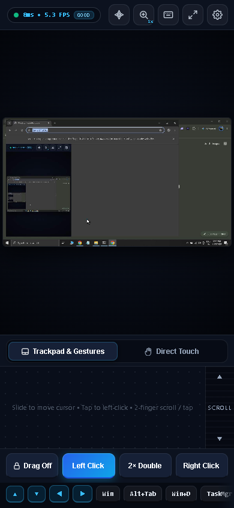
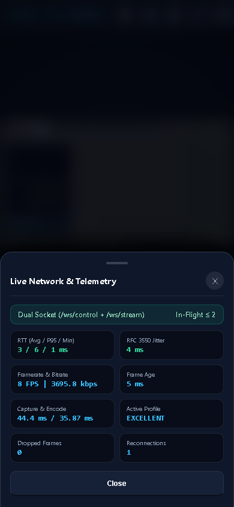
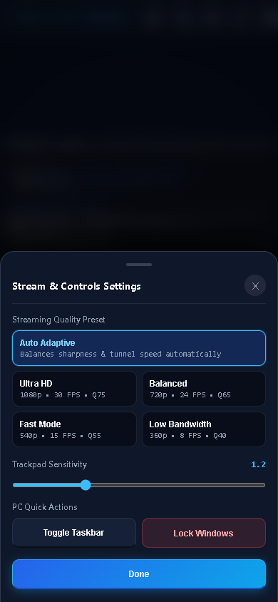

<div align="center">

# 🖥️ Windows Remote Screen Mirror Bot

**View and control your Windows 10/11 PC from any phone inside Telegram — with zero port forwarding, zero VPN setup, and sub-second responsiveness.**

[](https://www.python.org/downloads/)
[](https://fastapi.tiangolo.com/)
[](https://microsoft.com/windows)
[](LICENSE)

*Low-latency Telegram Mini App remote desktop • Dual-WebSocket streaming • Trackpad & Direct Touch • Cloudflare Quick Tunnel • Silent boot standby*

</div>

---

## Why Use This Instead of Traditional Remote Desktop Tools?

Most remote desktop apps force you to install heavy client software on your phone, create third-party accounts, or expose ports on your home router. **Windows Remote Screen Mirror Bot** turns your existing Telegram app into a private, hardware-responsive Windows remote control studio that you own end-to-end:

- **No Extra Mobile App:** Launches directly inside a mobile-first Telegram Mini App (`100dvh` dark workstation UI).
- **No Router Port Forwarding or Static IP:** Uses an outbound **Cloudflare Quick Tunnel** (`trycloudflare.com`) with an automatic reconnect watchdog.
- **No Bufferbloat Lag:** Unlike naive MJPEG/WebSocket streamers that pile up seconds of queued frames, dual WebSockets (`/ws/control` + `/ws/stream`) and `MAX_IN_FLIGHT = 4` client ACK pacing keep cursor and keyboard inputs snappy even on mobile data.
- **Zero Idle Capture When Not In Use:** Starts in dormant **standby mode** — screen capture and WebSocket streaming stay disabled until you explicitly send `/start` in Telegram.

---

## 📸 Screenshots & How It Works

<p align="center">
  
  &nbsp;&nbsp;
  
  &nbsp;&nbsp;
  
</p>

1. **Instant Mobile Control (`/ws/control` + `/ws/stream`)** — Control your PC with precision **Trackpad & Gestures** (cursor glide, tap-to-click, 2-finger scroll/right-click, Drag Lock, dedicated scroll strip) or **Direct Touch** (tap directly on any desktop element with visual tap rings).
2. **Real-Time Telemetry & Diagnostics** — Tap the top status pill to inspect Avg/P95/Min RTT, RFC 3550 jitter, FPS, bitrate, frame age, and active transport status.
3. **Adaptive Quality Without Crushing Sharpness** — Pick **Auto Adaptive**, or lock **Ultra HD (1080p / 30 FPS)**, **Balanced (720p / 24 FPS)**, **Fast Mode (540p / 15 FPS)**, or **Low Bandwidth (360p / 8 FPS)**, plus 1-tap **Zen Fullscreen** and **PC Quick Actions** (`Toggle Taskbar`, `Lock Windows`).

---

## ✨ Key Technical Features

- **Dual-Socket Low-Latency Transport:** Separates `ping`/`pong`, mouse, touch, and keyboard packets (`/ws/control`) from binary `TGFR` JPEG frames (`/ws/stream`) so inputs never wait behind video frames.
- **Anti-Bufferbloat Flow Control (`frame_ack`):** Caps unacknowledged frames in flight (`MAX_IN_FLIGHT_FRAMES = 4`) and pulls only the newest frame from per-client `SingleSlotFrameBuffer` slots.
- **CRC32 Static-Frame Skipping:** Skips redundant JPEG re-encodes when screen pixels and cursor coordinates are unchanged, saving CPU and bandwidth with a `0.5s` keepalive refresh.
- **1× / 1.5× / 2.2× Zoom & Zero-Lag Drag Pan:** Inspect small UI buttons or terminal text comfortably on a phone screen.
- **Virtual Keyboard & Shortcut Ribbon:** Type full text blocks or fire instant Windows shortcuts (`Win`, `Alt+Tab`, `Win+D`, `Ctrl+Shift+Esc`, `Alt+F4`, `Ctrl+C/V/Z`, Arrow D-Pad).
- **Fail-Closed Security:** Locks bot access to your numeric `ALLOWED_USER_ID`, enforces constant-time `SECRET_KEY` WebSocket auth with brute-force rate limiting, and prevents duplicate processes via a Win32 mutex + `.bot.pid`.

---

## 🏗️ System Architecture

```
  Telegram Mini App (Phone / Mobile WebView)
     ├── /ws/control  ──► ping/pong, mouse, touch, keyboard, presets
     └── /ws/stream   ◄── 32B TGFR binary JPEG frames + frame_ack pacing
            │
            ▼  (HTTPS / WSS via Cloudflare Quick Tunnel — zero open router ports)
  ┌──────────────────────────────────────────────────────────────┐
  │                 FastAPI + Supervisor (main.py)               │
  │  ├── ScreenCaptureBroadcaster (MSS + CRC32 idle skip)        │
  │  ├── SingleSlotFrameBuffer (per-client latest frame only)    │
  │  ├── AdaptiveStreamController (hysteresis + manual lock)     │
  │  ├── InputController (Win32 SendInput + virtual-screen map)  │
  │  └── Telegram Bot (standby /start, /stop, /screenshot, /cmd) │
  └──────────────────────────────────────────────────────────────┘
```

---

## 🚀 Step-by-Step Windows Setup (PowerShell)

### 1. Prerequisites
- **Windows 10 / 11 (64-bit)**
- **Python 3.11+** (`python --version`)
- **Cloudflare Tunnel (`cloudflared`)** — install via `winget install Cloudflare.cloudflared`
- A **Telegram Bot Token** from **`@BotFather`** and your numeric **Telegram User ID** from **`@userinfobot`**

### 2. Clone & Install Dependencies
Open **PowerShell** and run:

```powershell
git clone https://github.com/shubhambelbase/windows-remote-screen-mirror-bot.git
cd windows-remote-screen-mirror-bot

python -m venv .venv
.\.venv\Scripts\python.exe -m pip install --upgrade pip
.\.venv\Scripts\python.exe -m pip install -r requirements.txt
```

### 3. Configure `.env`
Create your local `.env` file from the template:

```powershell
Copy-Item .env.example .env
notepad .env
```

Set at minimum:
```env
TELEGRAM_BOT_TOKEN=123456789:your_bot_token_here
ALLOWED_USER_ID=123456789
SECRET_KEY=replace_with_a_long_random_secret
```

### 4. Start Controlling Your PC
```powershell
.\.venv\Scripts\python.exe execution\main.py
```

1. Open your bot in Telegram and send **`/start`**.
2. Tap **`🖥️ Open Remote Desktop`** to launch the live screen mirror Mini App.
3. Send **`/stop`** when done to put the host back into dormant standby mode.

---

## ⚙️ Optional: Silent Auto-Start on Windows Boot

Run the bot silently in standby mode on Windows login (no console window, powered by `pythonw.exe`). From **PowerShell** inside the cloned project directory:

```powershell
$ws = New-Object -ComObject WScript.Shell
$sc = $ws.CreateShortcut("$env:APPDATA\Microsoft\Windows\Start Menu\Programs\Startup\TelegramRemoteStudio.lnk")
$sc.TargetPath = "$env:WINDIR\System32\wscript.exe"
$sc.Arguments = "`"$((Get-Location).Path)\silent_start.vbs`""
$sc.WorkingDirectory = (Get-Location).Path
$sc.Save()
```

To remove auto-start:

```powershell
Remove-Item "$env:APPDATA\Microsoft\Windows\Start Menu\Programs\Startup\TelegramRemoteStudio.lnk" -ErrorAction SilentlyContinue
```

---

## 🎮 Telegram Bot Commands

| Command | Description |
| :--- | :--- |
| **`/start`** | Activates the remote session and sends the Mini App launch button. |
| **`/stop`** | Stops screen capture and returns the host to dormant standby mode. |
| **`/status`** | Displays host CPU, RAM, active Cloudflare Tunnel URL, and session state. |
| **`/screenshot`** | Captures and sends a full-quality desktop screenshot directly in chat. |
| **`/lock`** | Locks the Windows workstation immediately. |
| **`/cmd <command>`** | Runs a PowerShell command on the host and returns the output. |

---

## 🧪 Running Tests

```powershell
.\.venv\Scripts\python.exe -m pytest -v
```

*(Note: `tests/test_webrtc_experimental.py` is automatically skipped unless optional `aiortc` is installed).*

---

## 📄 License

Licensed under the MIT License — see [LICENSE](LICENSE).
